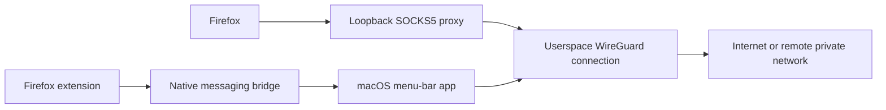

# Firefox WireGuard

A planned macOS menu-bar app and Firefox extension for routing Firefox browsing through a selected WireGuard connection.

## Project status

Project foundation and design only. The app, native messaging bridge, and extension have not been implemented. No tunnel, installation, privacy, or leak-prevention behaviour has been validated yet.

The repository is initially private. Keep its content suitable for possible public release: no personal references, real tunnel profiles, private infrastructure details, credentials, or machine-specific paths.

## Intended experience

1. Manage WireGuard profiles in a small macOS menu-bar app, with no Dock icon or Docker dependency.
2. Select a configured profile and connect or disconnect from the Firefox extension.
3. Send Firefox browsing through a loopback proxy backed by that profile's userspace WireGuard connection.
4. Keep localhost local. Permit private-network destinations through the tunnel when the selected profile and remote network support them.
5. Leave the Mac's system routing and system DNS configuration unchanged.
6. If an enabled connection fails, block affected Firefox browsing until it recovers or the user explicitly disables protection.

The native WireGuard Mac app is not required for this design. A compatible WireGuard server and an appropriate peer configuration are required. A server intended for Internet browsing must permit Internet egress.

## Planned traffic path

The implementation must account for Firefox DNS, IPv6, WebRTC, existing connections, startup, reconnect, and browser restart behaviour. A browser proxy is not a proven operating-system containment boundary. See the requirements for the intended protection scope and its validation gates.

## Project documents

- [Requirements and accepted scope](docs/requirements.md)
- [Architecture and component responsibilities](docs/architecture.md)
- [Implementation and validation roadmap](docs/roadmap.md)
- [Upstream references and distribution](docs/references.md)
- [Contribution and publication hygiene](CONTRIBUTING.md)

## Installation

There is no installable build yet. The planned installation consists of a native Mac app and a Firefox extension. The native messaging helper must be registered with Firefox separately from installing the extension.

The intended regular-Firefox distribution route is a Mozilla-signed, self-distributed extension. A public add-on listing is not required. Development builds can be loaded temporarily.

## Source and licensing

This repository currently contains original project documentation and repository configuration only. No source code or binaries have been copied from the referenced prototype or bundled from wireproxy. Select a project licence and record third-party licences before a public release or redistribution.
