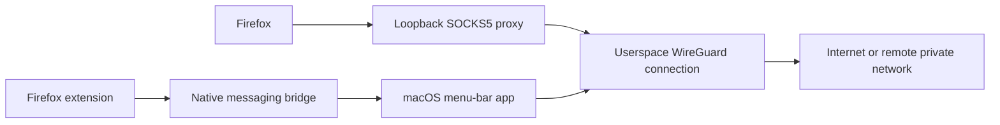

# Firefox WireGuard

A native macOS menu-bar app and Firefox extension that send Firefox browsing through a selected WireGuard connection. No Docker, system VPN routes, or system DNS changes.

## Native app 0.2.1 / extension 0.2.1

Both interfaces show the public exit IP and country flag, current-connection download/upload totals, tunnel DNS servers, and WireGuard client addresses. Firefox has a persistent **Kill switch**, on by default: detected failures block covered requests; switching it off permits normal browsing while the tunnel is unavailable. Direct browsing is clearly labelled.

Native 0.2.1 fixes app relaunch after Quit and recovery when another copy is running. Background status checks do not launch the app; an explicit Firefox Connect can. A replacement app updates an existing Firefox registration after acquiring ownership.

An Apple Silicon preview is available as a ready-to-run Mac download. It includes profile import/editing, Keychain storage, a native messaging bridge, a userspace WireGuard backend, and the Firefox profile picker. The encrypted proxy path and browser failure handling have been exercised locally. Manual remote browsing has been reported working; the full browser leak-testing matrix remains to be validated. See [test evidence and limitations](docs/validation.md).

This project is open source under the [Mozilla Public License 2.0](LICENSE). The Firefox add-on is named **WireGuard for Firefox**; the native companion keeps its existing name and identifiers.

Extension 0.2.1 was submitted for a public Mozilla Add-ons listing on 2026-10-15
and is awaiting review. It is not yet an approved, signed public release.
See the [submission record](docs/firefox-submission.md#submission-record).

## Try it

1. [Download Firefox WireGuard 0.2.1 for Apple Silicon](https://github.com/kristof-dragon/firefox-wireguard/releases/download/v0.2.1/Firefox-WireGuard-0.2.1-macOS-arm64.zip), unzip it, and move **Firefox WireGuard.app** to **Applications**. No developer tools, Docker, or separate WireGuard installation are needed.
2. Open the app. This preview is ad-hoc signed and **not notarized by Apple**. If macOS blocks it, follow the [first-launch instructions](docs/installation.md#download-the-mac-app). Its shield icon appears in the menu bar.
3. Choose **Install Firefox Integration**, then **Manage Profiles…** to import a supported full-tunnel configuration.
4. Temporarily load `extension/manifest.json` using Firefox's `about:debugging` page. Allow the extension in private windows.
5. Close existing tabs and downloads, then select a profile and **Connect** in the extension.

[Installation, supported configurations, updates, and removal](docs/installation.md) has the complete steps. The [GitHub release](https://github.com/kristof-dragon/firefox-wireguard/releases/tag/v0.2.1) includes checksums and matching source. The Firefox add-on is still awaiting Mozilla review; a downloaded Mac app does not replace the extension. Once approved, install it from the [Mozilla listing](https://addons.mozilla.org/firefox/addon/wireguard-for-firefox/).

## Behaviour

- Multiple stored profiles; one Firefox profile owns one active tunnel at a time.
- Localhost stays local. Other private addresses use the tunnel, subject to remote routing.
- With **Kill switch** on (default), new covered requests are blocked during connection setup and detected failures. With it off, an unavailable tunnel permits normal browsing. **Disconnect** explicitly returns to ordinary browsing.
- Public exit lookup uses HTTPS through the tunnel; see [connection details and privacy](docs/installation.md#connection-details).
- Proxied DNS uses the tunnel. WebRTC and network prediction are disabled while protected.
- The official WireGuard Mac app is not required. This creates its own connection; use a separate server peer if another client will run simultaneously.



The extension controls browser requests and settings; this is not an operating-system firewall. Existing connections, browser-internal traffic, extension removal, and several network/browser combinations have not been proven contained. Temporary extensions disappear on browser restart. Do not treat this development build as a complete privacy boundary.

## Development

```sh
scripts/build.sh
scripts/test.sh
FWG_TEST_KEYCHAIN=1 FWG_TEST_BACKEND=1 scripts/test.sh
python3 scripts/backend_integration.py
```

Opt-in tests use disposable Keychain entries and locally generated WireGuard peers. Local development downloads a checksum-verified wireproxy 1.1.3 binary. Public app releases rebuild the same version from verified source, remove build paths, and bundle reviewed third-party licences; see [Mac release packaging](docs/macos-releases.md). Build products, logs, and browser profiles are ignored by Git.

Declared minimums are macOS 13 and Firefox 140. The build was tested on Apple Silicon with macOS 27 and Firefox 157. Intel backend download support is included, but an Intel build has not been tested.

## Project documents

- [Installation](docs/installation.md)
- [Requirements](docs/requirements.md)
- [Architecture](docs/architecture.md)
- [Validation evidence and known limits](docs/validation.md)
- [Remaining roadmap](docs/roadmap.md)
- [Upstream references and distribution](docs/references.md)
- [Contribution and publication hygiene](CONTRIBUTING.md)
- [Third-party provenance](THIRD_PARTY.md)
- [Privacy and data transmission](docs/privacy.md)
- [Firefox listing and reviewer information](docs/firefox-submission.md)
- [Public-source audit](docs/publication-audit.md)

All original source, documentation, and assets are licensed under MPL-2.0, including files without inline notices such as the extension manifest. Third-party components retain their own licences; see [THIRD_PARTY.md](THIRD_PARTY.md). No code was copied from the referenced browser-extension prototype.

Firefox and WireGuard are trademarks of their respective owners. This is an independent project, not an official Mozilla or WireGuard application.
